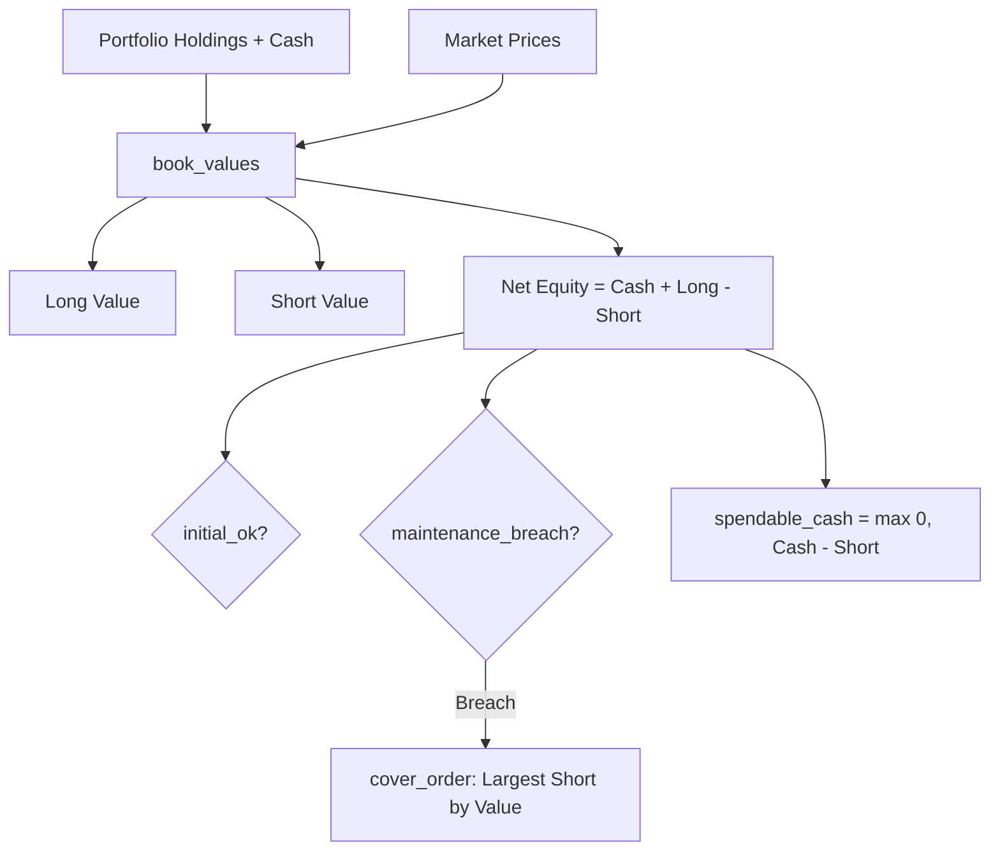

# Short Selling Architecture

> [!WARNING]
> **DISCLAIMER:** This software is for educational and research purposes only. Short selling involves significant risk of unlimited loss and margin liquidation. Use of this framework for live trading is strictly at your own risk.

This document describes the design, margin mechanics, borrow fee model, backtest parity, and broker execution for short selling in the Trading Bot Framework, modelled on Interactive Brokers (IBKR) and US Regulation T.

---

## 1. Design Rules

The short-selling engine enforces six structural design rules to prevent unintended shorts, runaway position doubling, and leverage inflation:

1. **A short is never a side effect.**
   `bot.sell()` and `PortfolioManager.sell()` clamp orders at zero. They only liquidate existing long positions. Crossing zero into a short position is only possible through explicit `bot.short()` / `bot.cover()` or signed target weights in `rebalancePortfolio()` on an opted-in bot.
2. **Opt-in per bot.**
   `ALLOW_SHORT = False` by default on the `Bot` base class. Non-opted bots cannot hold short positions: any attempt to execute a short trade or pass negative target weights raises an exception and rolls back the transaction. The AI/LLM tool surface (`run_ai_with_tools`) does not have shorting capabilities.
3. **Decision `-1` stays "exit".**
   In `decisionFunction(row)`, returning `-1` remains an exit signal (sell to cash). It never opens a short position. Short exposure is created exclusively via signed `targetWeights` or explicit `short()` calls.
4. **One transaction per rebalance.**
   When rebalancing, signed share deltas are calculated across the entire portfolio and validated atomically with database row locking (`with_for_update`). Position reductions and covers execute before expansions, ensuring a bot can always close or reduce positions even when initial margin for new positions is constrained.
5. **Fail closed on missing prices.**
   Valuing a short position at $0 would treat borrow proceeds as pure equity, falsely inflating portfolio worth and spendable cash. If any held short position lacks a positive, valid price from the data feed, valuation and margin checks immediately raise `MissingPriceError`.
6. **Whole shares only.**
   Short entries and cover orders are strictly floored to whole shares (`math.floor`). Fractional shares are never permitted on the short side.

---

## 2. IBKR Paper Model & Mapping

The paper execution engine mirrors Interactive Brokers margin, fee, and order routing semantics:

| IBKR Behavior | Framework Paper Model | Implementation |
|---|---|---|
| **Reg T Initial Margin (50%)** | Opens require `equity >= 0.5 * long + 0.5 * short` and gross leverage `(long + short) / equity <= max_gross` | `tradingbot.utils.margin.initial_ok` |
| **Maintenance Margin (~30% short, 25% long)** | Breached when `equity < 0.25 * long + 0.30 * short` | `tradingbot.utils.margin.maintenance_breach` |
| **Short Sale Proceeds Held as Collateral** | Short sale proceeds sit in cash (`USD`) but are reserved as collateral and cannot fund new long buys | `tradingbot.utils.margin.spendable_cash` |
| **Daily Borrow Fee Accrual** | Daily fee accrued based on short market value using Act/360 convention | `tradingbot.utils.short_carry.apply_carry` |
| **Dividends in Lieu** | Short positions are debited dividend amounts on the ex-dividend date | `tradingbot.utils.short_carry.apply_carry` |
| **Forced Liquidation** | Breaching maintenance margin force-covers the largest short position by market value | `tradingbot.utils.margin.cover_order` |
| **No Fractional Shorts** | Short quantities are floored to integer share counts | `math.floor(quantity_usd / price)` |
| **Shortable Universe** | Restricted to an allowlist of liquid ETFs and large-cap stocks | `tradingbot.utils.config.SHORTABLE` |

---

## 3. Margin Mathematics (`utils/margin.py`)

All margin, equity, and leverage calculations are implemented as pure functions without database or network I/O in `tradingbot/utils/margin.py`.



### Core Functions

- **`book_values(portfolio, prices) -> tuple[float, float, float]`**
  Calculates `(long_value, short_value, equity)`:
  $$\text{equity} = \text{cash} + \text{long\_value} - \text{short\_value}$$
  Excludes cash (`USD`), options contracts, and option underlying stock legs (which use `options.margin_requirement`). Fails closed by raising `MissingPriceError` if any unhedged stock lacks a valid positive price.

- **`initial_ok(portfolio, prices, max_gross=1.0) -> bool`**
  Validates whether a proposed portfolio satisfies both Regulation T initial margin and the bot's gross leverage ceiling:
  $$\text{equity} \ge 0.5 \times \text{long\_value} + 0.5 \times \text{short\_value}$$
  $$\frac{\text{long\_value} + \text{short\_value}}{\text{equity}} \le \text{max\_gross}$$

- **`maintenance_breach(portfolio, prices) -> bool`**
  Checks whether equity has fallen below minimum maintenance margin:
  $$\text{equity} < 0.25 \times \text{long\_value} + 0.30 \times \text{short\_value}$$
  Returns `True` when the account is in margin breach and liquidation is required.

- **`spendable_cash(portfolio, prices) -> float`**
  Computes cash available for long purchases, deducting short collateral:
  $$\text{spendable\_cash} = \max(0.0, \text{cash} - \text{short\_value})$$
  For a long-only book with zero short positions, `spendable_cash` equals total `USD` cash.

- **`cover_order(portfolio, prices) -> str | None`**
  Identifies the symbol of the short position with the largest current dollar market value (`abs(shares) * price`). Used during maintenance margin breach to liquidate risk starting with the largest liability.

---

## 4. Borrow Fees, Dividends, and Carry (`utils/short_carry.py`)

Daily carry adjustments run via `apply_carry(bot_name)` during scheduled maintenance (alongside corporate split adjustments):

### Borrow Fee Model
Short positions borrow shares and incur daily financing fees. The annual borrow fee rate defaults to `SHORT_BORROW_RATE_PCT = 1.0` (1.0% per annum) and can be customized per symbol via `SHORT_BORROW_OVERRIDES`:
$$\text{fee} = \text{market\_value} \times \frac{\text{annual\_rate}}{100} \times \frac{\text{days}}{360}$$
Fees are debited from the bot's `USD` cash balance and logged to the `cash_adjustments` table.

### Dividends in Lieu
When a held short position passes an ex-dividend date (`DividendEvent`), the borrower is obligated to make a payment in lieu of dividend to the lender:
$$\text{debit} = |\text{shares}| \times \text{dividend\_per\_share}$$
Debited from `USD` cash and recorded in `cash_adjustments` with `kind="dividend"`.

### Idempotency via `cash_adjustments`
Every carry deduction is committed to the `cash_adjustments` table with a composite primary key:
$$\text{PK} = (\text{bot\_name}, \text{date}, \text{symbol}, \text{kind})$$
If `apply_carry` is executed multiple times on the same date, duplicate rows are prevented and existing adjustments are skipped.

---

## 5. Backtest Parity (`utils/backtest.py`)

Backtesting shorts achieves strict parity with live paper execution:
- Evaluates `initial_ok(simulated, prices, max_gross)` before opening or expanding positions.
- Deducts slippage and commissions symmetrically on short entries (`price * (1 - slippage_pct)`) and covers (`price * (1 + slippage_pct)`).
- Enforces spendable cash constraints so short sale proceeds cannot be used to over-leverage long purchases.
- Supports zero-beta market-neutral sleeves and tracks borrow carry drag over backtest intervals.

---

## 6. Live Copier & Broker Adapters

The live trade copier (`tradingbot/livetrade/copier.py`) syncs paper bot portfolios to live broker accounts:

### Broker Support Flag
Every broker subclass of `LiveBroker` exposes:
```python
supports_short: bool = False
```

### Divergent Execution Paths
- **Brokers with `supports_short = False` (e.g. Collective2, eToro, MT5):**
  Negative stock weights are dropped during target weight calculation with an explicit log message:
  `"... short dropped (broker does not support short selling)"`.
  If an existing position read reveals an unexpected short position on a non-short broker, the symbol is aborted to prevent runaway position doubling.
- **Brokers with `supports_short = True` (Interactive Brokers):**
  Negative stock weights are retained. The copier generates `SHORT` and `COVER` order intents.
  - Opening / expanding a short position sends a `SHORT` order (`side="SELL"`).
  - Covering / reducing a short position sends a `COVER` order (`side="BUY"`).
  - Cover orders are never scaled down by cash clamps.

### Cash Parking Protection
The copier parks idle cash into yield instruments (such as `SHV`). To prevent short sale proceeds from being leveraged into cash proxy purchases, idle cash calculation uses gross exposure:
$$\text{gross} = \sum |w_i|$$
$$\text{idle\_cash} = 1.0 - \text{gross} - \text{cash\_buffer}$$

### Interactive Brokers Adapter (`tradingbot/livetrade/interactive_brokers.py`)
- Maps `SHORT -> SELL` and `COVER -> BUY`.
- Queries IBKR short availability (`reqMktData` tick type 46 / Shortable tick). If the shortable tick is $\le 2.5$ or unavailable, the short order is skipped with an informational log rather than throwing an exception.
- Truncates all quantities to whole shares.

---

## 7. Opting a Bot into Short Selling

To enable short selling in a custom bot, define the class-level controls on your bot subclass:

```python
from tradingbot.buybackdriftbot import BuybackDriftBot
from tradingbot.utils.botclass import Bot


class BuybackHedgedBot(Bot):
    """
    Market-neutral buyback drift sleeve hedged with short QQQ.
    """

    # 1. Enable short selling and negative target weights
    ALLOW_SHORT = True

    # 2. Set maximum gross leverage (e.g. 1.0 long + 1.0 short = 2.0 gross)
    MAX_GROSS = 2.0

    # 3. Specify shortable universe (or leave None for config.SHORTABLE)
    SHORTABLE = ("QQQ",)

    def __init__(self):
        super().__init__(
            "BuybackHedgedBot",
            tickers=["QQQ", "AAPL", "MSFT"],
            interval="1d",
            period="1y",
        )

    def makeOneIteration(self):
        long_signals = {"AAPL": 0.25, "MSFT": 0.25}
        total_long = sum(long_signals.values())

        if total_long > 0:
            # Symmetrical market-neutral hedge
            weights = {
                **long_signals,
                "QQQ": -total_long,
                "USD": 1.0 - total_long - (-total_long),
            }
            self.rebalancePortfolio(weights)
        else:
            # Liquidate to flat cash when no signals exist
            self.rebalancePortfolio({"USD": 1.0})
        return 0
```

---

## 8. Known Limitations

- **Stock Shorts Only**: Option contracts cannot be shorted using `bot.short()`. Option short legs (e.g. credit spreads, iron condors) are managed separately via `utils/options.py` and require structured margin.
- **No Dynamic Locates**: The paper model does not connect to hard-to-borrow locate auctions. Only easy-to-borrow names on the `SHORTABLE` list can be shorted.
- **Fixed Borrow Rates**: Borrow fees use `SHORT_BORROW_RATE_PCT` (default 1.0% annual) or static `SHORT_BORROW_OVERRIDES`, not dynamic market-clearing borrow rates.
- **IB Session Status**: Live IB execution remains paper-only until the upstream IB Gateway session bridge is finalized.
